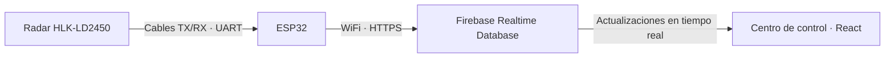

# thalos-web

Thalos muestra en una página web las detecciones reales de un radar HLK-LD2450 conectado a una ESP32. La primera versión usa un robot fijo.



## Dónde está cada cosa

| Carpeta | Contenido |
| --- | --- |
| `src/` | La página: pantallas, dibujo del radar y conexión a Firebase. |
| `firmware/` | El programa de la ESP32, sus conexiones y pruebas del sensor. |
| `firebase/` | Reglas de acceso, pruebas de permisos y ejemplos separados en `examples/`. |
| `tests/` | Pruebas de cómo la web interpreta las lecturas. |
| `public/`, `src/assets/` | Logo, favicon e imágenes de la página. |

## Abrir la página

Desde la raíz del repositorio, con Node.js 22.18 o posterior:

```sh
npm install
npm run dev
```

Abre la dirección que muestre Vite y entra en `/dashboard`. Detén el servidor con Ctrl+C cuando termines.

La configuración web está en `.env.local`. Para una instalación nueva, copia `.env.example` a `.env.local` y completa la configuración pública de Firebase.

Las credenciales de la ESP32 están separadas en `firmware/.env.local`: WiFi y cuenta del dispositivo en Firebase. Ambos archivos locales están excluidos de Git. La plantilla del dispositivo es `firmware/.env.example`.

**Cambiar el WiFi requiere volver a compilar y cargar la ESP32.** Cambiar la configuración web requiere reiniciar Vite. Para las conexiones y la carga del programa consulta [la guía de la ESP32](firmware/README.md).

## Testing de la matriz térmica

En `/testing` está el laboratorio para la AMG8831, con 64 píxeles, escala fija o automática, selección de píxeles y ajustes de orientación. Empieza sin mediciones ni datos simulados.

Para una prueba local, pega un bloque de ocho filas de la consola (se acepta el encabezado `AMG8831 - grados C:`), un arreglo JSON de 64 números o una matriz JSON de 8 × 8. También puedes abrir un archivo `.txt`, `.csv` o `.json` y pulsar **Visualizar lectura**. Usa punto decimal y carga solo un cuadro por vez. La unidad se selecciona explícitamente: grados Celsius para la salida de consola propuesta, o centésimas para los enteros del driver.

Los archivos se procesan en el navegador y no se envían a Firebase. Girar o reflejar cambia la vista y conserva los índices de los píxeles. Las temperaturas se colorean según la escala indicada; los colores no clasifican humanos ni animales. En modo manual, la hora mostrada es la de carga local.

El modo **En vivo** recibe las 64 temperaturas desde Firebase y conserva su hora de recepción en la ESP32. Si dejan de llegar durante cinco segundos, la última matriz se muestra como caducada; un heartbeat de la placa no la vuelve a hacer vigente. El modo **Carga manual** conserva las pruebas locales y no escribe en Firebase. La interpretación de lecturas está en `src/lib/thermal.ts` y la vista en `src/pages/testing-page.tsx`.

Para preparar el envío real desde la NUCLEO, sigue [la guía de nucleo_firebase](firmware/nucleo_firebase/README.md): publica las reglas actualizadas y carga ese firmware en la ESP32. Las pruebas UART y el firmware anterior del LD2450 se conservan por separado. La NUCLEO continúa con el bloque UART5 ya verificado.

## Comprobar cambios

```sh
npm test
npm run lint
npm run build
```

Las pruebas de permisos de Firebase necesitan su emulador y se ejecutan por separado. Las instrucciones están en [la guía de la ESP32](firmware/README.md).

## Guías

- [Cableado, carga y solución de problemas de la ESP32](firmware/README.md).

`node_modules/`, `dist/`, `.pio/` y `firmware/.build/` contienen dependencias o archivos locales de desarrollo; no son código que debas editar ni se suben a Git. `firmware/.build/` también conserva las capturas de las pruebas físicas.
