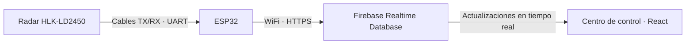

# thalos-web

Thalos muestra en una página web las detecciones reales de un radar HLK-LD2450 conectado a una ESP32. La primera versión usa un robot fijo.



**Empieza por [Cómo funciona y para qué sirve cada archivo](docs/como-funciona.md).**

## Dónde está cada cosa

| Carpeta | Contenido |
| --- | --- |
| `src/` | La página: pantallas, dibujo del radar y conexión a Firebase. |
| `firmware/` | El programa de la ESP32, sus conexiones y pruebas del sensor. |
| `firebase/` | Reglas de acceso, pruebas de permisos y ejemplos separados en `examples/`. |
| `tests/` | Pruebas de cómo la web interpreta las lecturas. |
| `docs/` | Explicación del sistema y detalles técnicos de la telemetría. |
| `public/`, `src/assets/` | Logo, favicon e imágenes de la página. |

## Abrir la página

Desde la raíz del repositorio, con Node.js 22.18 o posterior:

```sh
npm install
npm run dev
```

Abre la dirección que muestre Vite y entra en `/dashboard`. Detén el servidor con Ctrl+C cuando termines.

La configuración web está en `.env.local`. Para una instalación nueva, copia `.env.example` a `.env.local` y completa la configuración pública de Firebase.

Las credenciales de la ESP32 están separadas en `firmware/.env.local`: WiFi y cuenta del dispositivo en Firebase. Ambos archivos locales están excluidos de Git. La plantilla del dispositivo es `firmware/.env.example`.

**Cambiar el WiFi requiere volver a compilar y cargar la ESP32.** Cambiar la configuración web requiere reiniciar Vite. Para las conexiones y la carga del programa consulta [la guía de la ESP32](firmware/README.md).

## Comprobar cambios

```sh
npm test
npm run lint
npm run build
```

Las pruebas de permisos de Firebase necesitan su emulador y se ejecutan por separado. Las instrucciones están en [la guía de la ESP32](firmware/README.md).

## Guías

- [Cómo funciona y mapa de archivos](docs/como-funciona.md).
- [Configuración de Firebase, formato de datos y comportamiento del tablero](docs/telemetria.md).
- [Cableado, carga y solución de problemas de la ESP32](firmware/README.md).

`node_modules/`, `dist/`, `.pio/` y `firmware/.build/` contienen dependencias o archivos locales de desarrollo; no son código que debas editar ni se suben a Git. `firmware/.build/` también conserva las capturas de las pruebas físicas.
