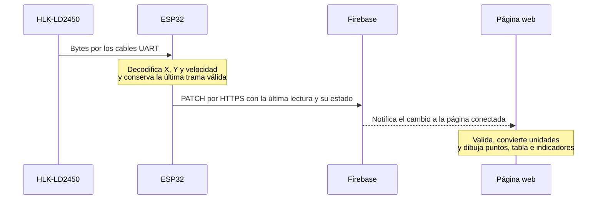

# Cómo funciona Thalos

El proyecto tiene tres partes: el programa de la ESP32, Firebase y la página web. Trabajan juntas, pero cada una se ejecuta en un lugar diferente.

## El recorrido de una lectura



1. **El radar mide.** Entrega hasta tres objetivos, con X, Y, velocidad y resolución. Lo conectamos a la ESP32 por TX/RX; el radar no se conecta directamente a Firebase.
2. **La ESP32 traduce y envía.** Lee los bytes por UART, reconoce una trama válida y extrae sus números. Por separado se conecta al WiFi, inicia sesión en Firebase con la cuenta del dispositivo y manda un JSON mediante HTTPS. El código usa PATCH para actualizar solo las rutas del dispositivo.
3. **Firebase guarda y distribuye.** Conserva la última lectura y comprueba quién tiene permiso para escribir. Cuando cambia un dato, avisa a las páginas que lo están escuchando.
4. **React lo muestra.** La página inicia una sesión anónima de lectura, escucha Firebase, valida los datos y actualiza el radar y la tabla. No hace falta recargar cada vez que llega una muestra.

La ESP32 intenta publicar como máximo una vez cada 500 ms; la red puede hacer que tarde más. La lectura UART sigue funcionando mientras se realiza el envío. No se acumula una cola de mediciones al perder el WiFi: al reconectar se toma la última lectura vigente.

## Un ejemplo concreto

Si el sensor envía `xMm = 1000` e `yMm = 2000`, la web muestra X = 1 m e Y = 2 m. Calcula la distancia como `sqrt(1² + 2²)`, aproximadamente 2.24 m, y el ángulo como `atan2(X, Y)`, aproximadamente +26.6°.

El mapa está en **vista espejo**: ese X positivo se dibuja a la izquierda del centro y el negativo a la derecha. Las etiquetas del mapa también se reflejan. Los valores de la tabla conservan el signo que reportó el sensor. Esta transformación ocurre en el dibujo; los datos almacenados siguen siendo los originales.

Distancia y ángulo son cálculos de la web. X, Y, velocidad y resolución vienen del radar. T1, T2 y T3 son ranuras del sensor; no identifican permanentemente a una persona. La resolución no es un porcentaje de confianza.

## Qué guardamos en Firebase

```text
telemetry/
  devices/
    robot-01/
      status/               Estado de la ESP32 y hora del último reporte
      sensors/
        ld2450/             Última lectura válida del radar
  events/                   Ruta opcional que la página puede leer
```

`status` incluye `lastSeenAt`, versión del programa y señal WiFi. `ld2450` incluye `updatedAt`, `sequence`, `targetCount` y los objetivos activos. El estado usa hora del servidor; la lectura conserva su hora de captura con el reloj de la ESP32 sincronizado.

**Actualmente guardamos la última lectura, no un historial completo de todos los movimientos.** Cada nueva lectura reemplaza la anterior en esa ruta. Los eventos que genera la página se conservan solo en esa sesión del navegador; la ESP32 no publica eventos remotos en esta versión.

## Por qué hay tres indicadores

| Indicador | Qué confirma |
| --- | --- |
| Firebase | La página está conectada a la base de datos. |
| ESP32 | La placa ha reportado actividad en los últimos 15 segundos. |
| Radar | Hay una lectura válida de los últimos 5 segundos y la placa tiene un reporte reciente. |

Si el radar deja de mandar tramas, la ESP32 puede seguir conectada y enviando su estado. Por eso no es suficiente que Firebase esté verde. Un cero recibido en una trama válida significa cero objetivos; la falta de tramas se muestra como datos sin vigencia.

## Dónde se ejecuta cada parte

- El radar mide físicamente y la ESP32 ejecuta el firmware cargado en su memoria.
- Firebase se ejecuta en la nube y funciona como el backend que usamos ahora: autenticación, almacenamiento y distribución de las lecturas.
- La web se ejecuta en el navegador. Vite sirve la página durante el desarrollo y prepara los archivos para publicarla; no está encargado de recibir el sensor.

La ESP32 puede seguir enviando aunque cierres la página o desconectes el cable de datos del Mac, siempre que conserve alimentación y acceso al WiFi. La página y la ESP32 no necesitan estar en la misma red: ambas necesitan acceso a Firebase por Internet. Para ver la web local, el servidor Vite sí debe estar encendido en el Mac.

## Mapa de los archivos de la web

Las rutas de las tablas parten de la raíz del repositorio.

| Archivo o carpeta | Para qué sirve |
| --- | --- |
| `src/main.tsx` | Inicia React dentro de la página HTML. |
| `src/App.tsx` | Decide qué pantalla abrir según la URL: inicio, solución o centro de control. |
| `src/pages/dashboard-page.tsx` | Arma el centro de control: indicadores, resumen, radar, detalle y tabla. |
| `src/components/radar-view.tsx` | Dibuja el radar y sus puntos; aquí está la vista espejo. |
| `src/hooks/use-telemetry.ts` | Mantiene la escucha de Firebase y entrega las lecturas a la pantalla. Un hook es una función de React que concentra esta lógica. |
| `src/lib/firebase.ts` | Inicializa Firebase y la sesión anónima que usa la web para leer. |
| `src/lib/firebase-config.ts` | Lee la configuración del archivo local y comprueba que esté completa. |
| `src/lib/telemetry.ts` | Valida los datos, calcula distancia y ángulo y decide si una lectura sigue vigente. |
| `src/lib/radar-colors.ts` | Comparte los colores T1–T3 entre el radar, los botones y la tabla. |
| `src/vite-env.d.ts` | Ayuda a TypeScript a reconocer las variables de Vite. |
| `src/pages/home-page.tsx`, `solution-page.tsx` | Las otras pantallas de la página. |
| `src/components/site-header.tsx`, `site-footer.tsx`, `brand-mark.tsx` | Navegación, pie de página y marca. |
| `src/components/factory-preview.tsx`, `src/components/ui/`, `src/lib/utils.ts` | Piezas visuales y utilidades compartidas de la web. |
| `src/index.css`, `src/App.css` | Estilos de la página y animaciones. Ambos se usan. |
| `src/assets/`, `public/` | Imágenes, logo y favicon. |

Separar conexión, validación y dibujo permite añadir otro sensor sin tener que reescribir toda la pantalla. Por eso varios archivos pequeños siguen siendo útiles.

## Mapa de los archivos de la ESP32

**El programa que estamos usando es `firmware/ld2450_firebase/`.**

| Archivo o carpeta | Para qué sirve |
| --- | --- |
| `firmware/ld2450_firebase/main.cpp` | Programa principal de la placa: UART, WiFi, autenticación y envíos HTTPS. |
| `firmware/ld2450_firebase/TelemetryPayload.h` | Construye el JSON y evita volver a publicar como nuevas las lecturas repetidas o caducadas. |
| `firmware/ld2450_serial_test/Ld2450Parser.h` | Traduce la trama binaria del radar a números. Lo comparten el programa principal y la prueba USB. |
| `firmware/ld2450_firebase/GoogleRoots.h` | Certificados públicos para verificar que los servidores HTTPS sean auténticos. No contiene contraseñas. |
| `firmware/ld2450_firebase/load_env.py` | Lee las credenciales locales al compilar y genera el encabezado privado. No se ejecuta en la placa. |
| `firmware/ld2450_firebase/platformio.ini` | Indica a PlatformIO qué placa, herramientas y librerías debe usar para compilar y cargar. |
| `firmware/ld2450_serial_test/` | Programa de diagnóstico por USB, sin WiFi; se conserva para aislar problemas del radar. Su `platformio.ini` configura esa prueba. |
| `firmware/README.md` | Conexiones y pasos de compilación, carga y diagnóstico. |

El archivo `.h` es una pieza de código que usa otro archivo C++; no implica un programa adicional corriendo. La ESP32 ejecuta el programa que cargamos por última vez, no los dos proyectos a la vez.

## Configuración, permisos y pruebas

| Archivo o carpeta | Para qué sirve |
| --- | --- |
| `.env.local` | Configuración pública de Firebase para la web. |
| `firmware/.env.local` | Credenciales WiFi y de la cuenta dedicada a la ESP32. |
| `.env.example`, `firmware/.env.example` | Plantillas sin credenciales para preparar otra computadora. |
| `firebase/database.rules.json` | Permite leer a sesiones autenticadas y escribir solo a la cuenta de la ESP32 en las rutas autorizadas. Se publica desde la consola de Firebase. |
| `firebase/examples/` | JSON de pruebas simuladas; no se carga automáticamente ni es necesario para las lecturas reales. |
| `tests/telemetry.test.mjs` | Comprueba la interpretación de datos en la web. |
| `firmware/tests/` | Comprueba la decodificación UART y la construcción del JSON. |
| `firebase/tests/` | Comprueba los permisos en un emulador local, sin modificar la base real. |
| `package.json` | Lista dependencias y comandos de la web. |
| `package-lock.json` | Fija las versiones que instaló npm; no se edita a mano. |
| `vite.config.ts`, `tsconfig*.json`, `eslint.config.js` | Configuración para desarrollar, compilar y revisar la web. |
| `components.json` | Configuración del sistema de componentes visuales. |
| `index.html` | Documento HTML que carga la aplicación. |
| `.gitignore` | Excluye credenciales, dependencias y archivos generados del repositorio. |
| `AGENTS.md` | Instrucciones de trabajo para el asistente; no forma parte de la aplicación. |

Las variables `VITE_` son visibles en el navegador. Las contraseñas WiFi y de la ESP32 deben quedarse en el archivo local del firmware. El UID identifica la cuenta autorizada, pero no reemplaza su contraseña ni es un token de acceso. Los certificados de `GoogleRoots.h` también son públicos.

## Carpetas que no debes editar

| Carpeta | Qué contiene |
| --- | --- |
| `node_modules/` | Dependencias de la web instaladas por npm. |
| `dist/` | La versión compilada de la web; se regenera con `npm run build`. |
| `firmware/**/.pio/` | Dependencias y compilaciones de PlatformIO; incluye archivos generados con credenciales. |
| `firmware/**/__pycache__/` | Caché de Python. |
| `firmware/.build/` | Ejecutables de pruebas, emulador y capturas locales de las pruebas físicas. Las capturas son evidencia de esas pruebas, no código del producto. |

Todas estas carpetas están excluidas de Git. No necesitas leer miles de archivos de dependencias para entender el proyecto.

## Qué archivo tocar cuando quieras cambiar algo

| Quieres cambiar… | Empieza aquí |
| --- | --- |
| El diseño del centro de control | `src/pages/dashboard-page.tsx` |
| El radar, su escala o su vista espejo | `src/components/radar-view.tsx` |
| Cómo interpretar una lectura en la web | `src/lib/telemetry.ts` |
| El WiFi del dispositivo | `firmware/.env.local`, y luego volver a compilar y cargar |
| Cómo recibe o transmite la ESP32 | `firmware/ld2450_firebase/main.cpp` |
| Los permisos de lectura o escritura | `firebase/database.rules.json`, y luego publicar las reglas |
| Agregar otro sensor | Acordar primero sus datos y su ruta en Firebase; después modificar el firmware, la escucha y la pantalla. |

Para el formato exacto de las lecturas consulta [la guía técnica](telemetria.md). Para el montaje y la carga consulta [la guía de la ESP32](../firmware/README.md).
